# ESP32 Motion Security System with Telegram Alerts

A wireless motion detector built on an **ESP32**. When a **PIR sensor** picks up movement, the ESP32 sends an alert to my phone through a **Telegram bot** over Wi-Fi. An **LDR** checks the light level, and the external warning LED only turns on in the dark, to save power. The bot also takes commands, so I can check live sensor readings or change the dark threshold from my phone.

Designed, built and demonstrated as a breadboard prototype for my Advanced Diploma of Electronics and Communications Engineering (RMIT, 2026).

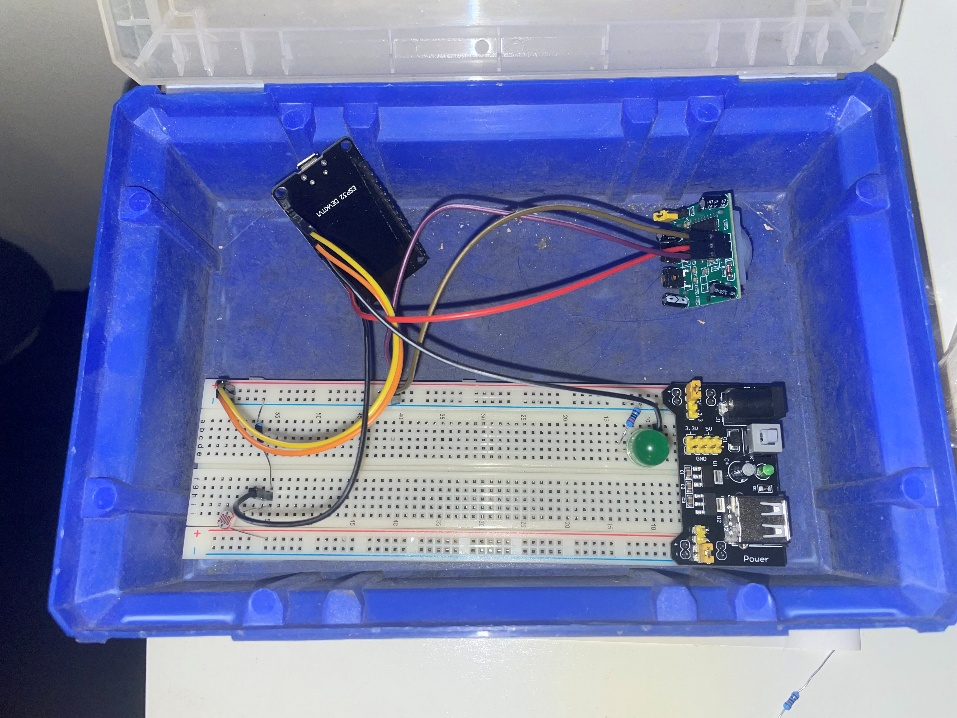

## How it works

1. The PIR sensor detects body heat moving in front of it.
2. The ESP32 reads the LDR to see whether the room is light or dark.
3. When there's motion, the on-board blue LED turns on and a Telegram alert is sent to my phone.
4. If the room is dark, the external LED turns on as well. In a lit room it stays off to save power.
5. There's a 10-second cooldown before another alert can be sent.
6. Every 2 seconds, the ESP32 checks Telegram for commands. It only accepts commands from my own chat ID, and anyone else gets "Unauthorised".

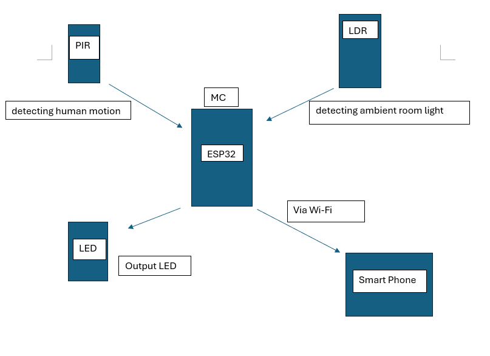

### Telegram bot

| Boot message | Motion in the dark | Motion in a lit room |
|---|---|---|
| 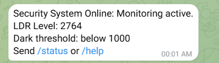 | 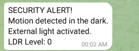 | 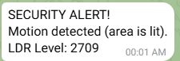 |

| Command | What it does |
|---|---|
| `/status` | Live LDR level, PIR state, threshold, Wi-Fi signal strength and uptime |
| `/threshold` | Shows the current dark threshold |
| `/threshold 400` | Sets a new dark threshold (1–4095). It's saved in flash, so it survives a power cycle |
| `/help` | Lists the commands |

## Circuit

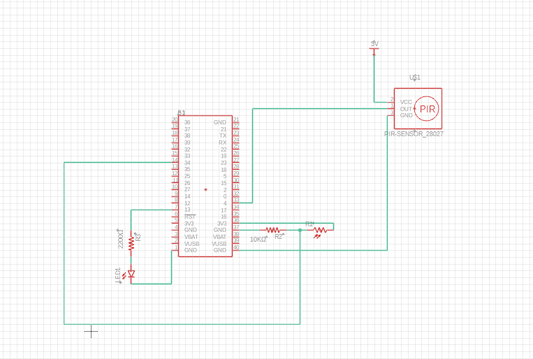

| Part | Connections |
|---|---|
| **PIR motion sensor** (HC-SR501) | VCC → 5 V rail, OUT → GPIO25, GND → ground |
| **LDR light sensor** | 3.3 V → LDR → GPIO34 → 10 kΩ resistor → ground (darker = lower reading) |
| **External LED** | GPIO13 → 220 Ω resistor → LED → ground |
| **Power** | Breadboard power module. The ESP32 and all sensors share one ground rail |

GPIO34 is on ADC1, which keeps working while Wi-Fi is on. ADC2 pins don't work while Wi-Fi is active on the ESP32.

## Testing

I tested the analogue parts of the circuit in **Multisim** before building them. Multisim can't simulate the ESP32 itself. I tested the firmware and the Telegram link on the real board, using the Arduino IDE Serial Monitor at 115200 baud.

### LDR voltage divider

A 1 MΩ potentiometer stood in for the LDR, in series with the 10 kΩ resistor from 3.3 V. A multimeter measured the voltage across the 10 kΩ resistor, which is the voltage the ESP32 reads on GPIO34.

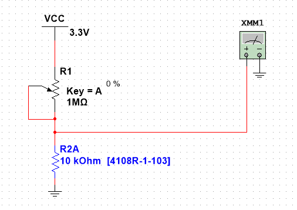

| Condition | Pot setting | LDR resistance | Measured voltage | ESP32 reading (0–4095) | Result |
|---|---|---|---|---|---|
| Dark | 0% | ~1 MΩ | 32.673 mV | ~41 | Dark (below 1000) → external LED on |
| In between | 50% | ~500 kΩ | 64.705 mV | ~80 | Dark |
| Bright | 98% | ~20 kΩ | 1.1 V | ~1365 | Bright (above 1000) → external LED off |

The measured voltages match the divider formula V = 3.3 × 10k / (10k + R_LDR). For example, 3.3 × 10k / 30k = 1.1 V. The default dark threshold of 1000 sits between the dark and bright readings, so the switch-over is clean.

| Dark (0%) | 50% | Bright (98%) |
|---|---|---|
| 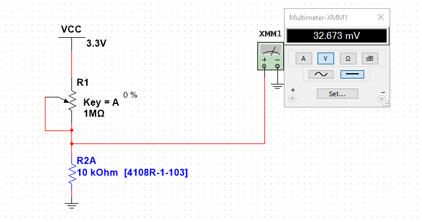 | 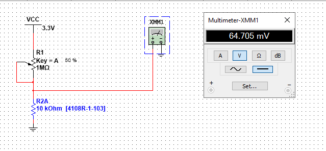 | 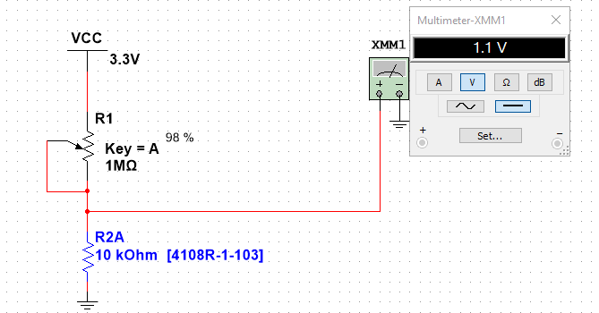 |

### LED current

| Measurement | Value |
|---|---|
| Supply | 3.3 V (ESP32 GPIO high) |
| Series resistor | 220 Ω |
| Measured current | **5.76 mA** |
| LED | On |

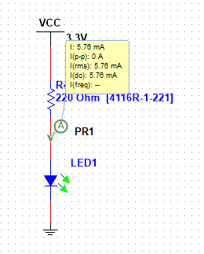

5.76 mA is well under the LED's maximum current and the ESP32 pin's limit, so the 220 Ω resistor protects both.

### On the real board

- The Serial Monitor showed the live LDR level, the PIR state and whether each Telegram message sent or failed.
- The Telegram alerts arrived on my phone for motion in the dark and in a lit room (see the screenshots above).
- The `/status` and `/threshold` commands worked from the phone.
- I demonstrated the finished prototype to my assessor on 13/10/2026.

## Code

[`esp32_security_system/esp32_security_system.ino`](esp32_security_system/esp32_security_system.ino), written in C++ with the Arduino framework.

- `WiFi` and `WiFiClientSecure` connect to Wi-Fi and the Telegram API over HTTPS.
- [`UniversalTelegramBot`](https://github.com/witnessmenow/Universal-Arduino-Telegram-Bot) sends alerts and reads commands.
- `Preferences` saves the dark threshold in the ESP32's flash.
- On boot, there's a 60-second PIR warm-up, because the sensor's output is unreliable until it settles.
- Timing uses `millis()`, so the loop never blocks while waiting for a cooldown.

### Run it yourself

1. Install the **Arduino IDE** and the **ESP32 board package** (Espressif).
2. Install these libraries: **UniversalTelegramBot** and **ArduinoJson**.
3. Create a bot with **@BotFather** on Telegram and get your chat ID.
4. Copy `secrets.example.h` to `secrets.h` and fill in your Wi-Fi details, bot token and chat ID.
5. Select **ESP32 Dev Module**, upload, and open the Serial Monitor at 115200 baud.

## Parts

ESP32 dev board (Wi-Fi + Bluetooth), HC-SR501 PIR sensor, LDR, 10 kΩ and 220 Ω resistors, LED, breadboard, breadboard power module and jumper wires. The total cost was about $15 for the ESP32 plus a few dollars for the other parts.

## What I learned

- Reading digital and analogue sensors on the ESP32, and why ADC1 has to be used when Wi-Fi is on.
- Talking to a web API (Telegram) from a microcontroller over HTTPS.
- Writing non-blocking code with `millis()` instead of `delay()`, so the system can watch the sensor and check for commands at the same time.
- Keeping a device secure with a chat-ID check, and keeping credentials out of public code.
- Simulating the circuit first (Multisim), then building and testing it on a breadboard.
